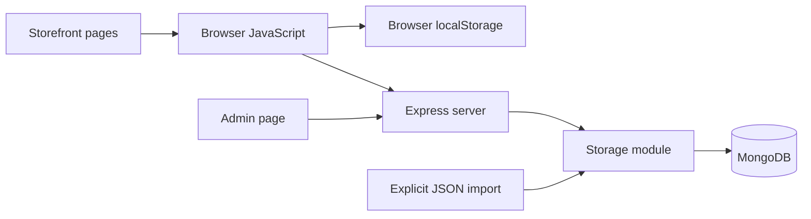

# EasyKart project guide

This guide explains the existing implementation for a project handover or viva.
It describes how the checked-in pages, server and database work together.
It does not introduce additional application features.

For installation, use the [README](../README.md).
For a live walkthrough, use the [demo checklist](demo-checklist.md).
For the full process and sequence diagrams, use the [project workflow](project-workflow.md).
For connection failures, use [Atlas troubleshooting](atlas-troubleshooting.md).
For test commands, use the [testing guide](testing.md).

## Architecture at a glance

EasyKart has three main layers: browser pages, a local Express server and MongoDB.
The browser displays products and collects shopping input.
The server validates submitted data and performs database operations.
MongoDB retains the product catalog and saved shopping records.



The browser does not receive the database connection string.
Database access runs in Node through the official MongoDB driver.
The application listens on `127.0.0.1:8000` for a local classroom demonstration.

## Source file responsibilities

| File or folder | Responsibility |
| --- | --- |
| `index.html` | Home page and voice-shopping entry point |
| `categories.html` | Product category navigation |
| `products.html` | Product results and search controls |
| `cart.html` | Cart display, quantity controls and checkout form |
| `help.html` | Help request form |
| `admin.html` and `admin.js` | Admin login, dashboard and order status controls |
| `script.js` | Product rendering, typed search, local cart storage and Help submission |
| `shop.js` | Cart feedback, server synchronization and checkout handling |
| `voice.js` | Browser speech recognition and spoken prompts |
| `style.css` | Shared page styling |
| `server.js` | Local HTTP server, public file serving, health, products and Help routes |
| `commerce.js` | Anonymous visitor cookies, checkout and admin routes |
| `storage.js` | MongoDB connection, indexes, queries and writes |
| `config.js` | Loading the project's private environment file |
| `import-data.js` | Validating and importing the initial JSON sources |
| `catalog.json` | Product seed data for the explicit import |
| `images/` | Checked-in product image assets |
| `test/` | Offline checks and the separate MongoDB integration runner |

These are responsibility boundaries, rather than separate deployed services.
Express and the storage module run in the same Node process.

## What happens during startup

1. `npm start` invokes `node server.js`.
2. `config.js` loads `.env` from the project directory if that file exists.
3. Storage configuration reads the URI and selected database name.
4. The MongoDB client connects and sends a database ping.
5. The storage module creates the indexes required by the application.
6. Only after those steps succeed does Express begin listening on port 8000.
7. The terminal prints the local site address and current admin password.

Starting the server does not import `catalog.json` automatically.
The explicit `npm run db:import` command prepares a fresh database separately.
Missing configuration or an unavailable database prevents normal startup.
Once the process is running, the health endpoint reports current connectivity.

Existing variables in the terminal environment take precedence over `.env` values.
Restart Node after changing configuration so the process loads the new values.
Changing `MONGODB_DB_NAME` selects another database; it does not move existing data.

## Product discovery

Product rendering requests the catalog from the Express server.
The server reads the `products` collection and returns records sorted by name.
The browser then applies the selected category and search terms to that list.
Voice search passes recognized words into the product-search flow.

Budget words affect the comparison used by the browser:

| Search wording | Price comparison |
| --- | --- |
| `under`, `below`, `less than` | Product price is strictly less than the limit |
| `up to`, `at most` | Product price may equal the limit |

For example, an item priced at INR 100 is excluded by `under 100` and included by
`up to 100`, provided its name matches the other search terms.
An empty result can therefore reflect a filter rather than a database failure.

After the initial product import has completed, edit live products in MongoDB.
Editing the seed JSON alone does not update an already imported catalog.
Saved orders retain the product details captured at checkout.

## Cart state in the browser and database

The browser stores its cart under the localStorage key `easykartCart`.
That value is JSON text containing the selected items and quantities.
The cart badge counts quantities, rather than just distinct product names.

The server uses the `ek_visitor` cookie to identify an anonymous browser session.
Starting a session returns an abbreviated ID for display.
It does not return the visitor's previously saved MongoDB cart.

When a shopper edits the cart:

1. Browser JavaScript updates localStorage and redraws the cart.
2. The browser obtains a visitor session if it needs one.
3. `shop.js` queues a request to synchronize the current items.
4. The server checks product names and quantities against the live catalog.
5. Storage updates the cart document identified by the full visitor ID.

An empty synchronized cart removes the corresponding cart document.
An unsuccessful synchronization does not by itself prove browser storage failed.
The checkout page reports when the cart remains saved only in the browser.
Other tabs receive storage events and update their cart badge and synchronization.

Use the same hostname throughout a demonstration.
`localhost` and `127.0.0.1` have separate browser storage and cookie contexts.
Opening another browser profile or device does not restore the original cart.

## Checkout and trusted totals

Checkout collects a name, email and delivery address alongside the selected items.
The browser generates a request ID for the checkout attempt.
The server checks customer fields, product names and quantities before saving.
It uses current MongoDB product prices to calculate the order total.

For example, if the live product price is INR 200 and the requested quantity is 2,
the server calculates INR 400 even if a submitted item claims a different price.
The saved order embeds item details and customer details for that purchase.
Later catalog edits do not recalculate this saved order snapshot.

The initial order status is `New`.
The payment field explicitly records that this is a demo with no payment collected.
The browser displays a receipt using an abbreviated form of the order ID.
The database retains the full ID, which is also used for admin status requests.

### Retry behavior

The browser retains a pending checkout payload in page memory after a network
failure or server error and offers to retry that same request.
The visitor ID and request ID together identify the original checkout attempt.
A unique database index and an upsert prevent concurrent retries from creating
multiple orders for that same pair.

A newly created order returns HTTP 201; an existing retry returns HTTP 200.
The server clears the checked-out cart when appropriate, while preserving a cart
whose update timestamp is newer than the saved order.
The browser also subtracts purchased quantities instead of discarding additions
made in another tab during checkout.

The pending request is not stored as a durable recovery record across page reloads.
For a retry demonstration, use the same checkout page without reloading it.
A different request ID represents a different checkout attempt.

## Admin behavior

Admin login creates a random session token and sends it in the `ek_admin` cookie.
The server stores session expiry in process memory for up to eight hours.
Restarting Node invalidates those sessions, even when saved orders remain intact.
If no admin password is configured, startup generates and prints a new one.

The dashboard loads orders, active carts and Help requests from MongoDB.
Use its Refresh control to load activity recorded since the previous refresh.
The cart view omits the full visitor ID and shows the abbreviated visitor label.
Visitor labels identify anonymous activity, not verified customer accounts.

Allowed order statuses are `New`, `Confirmed`, `Packed`, `Delivered` and `Cancelled`.
The implementation validates membership in that list; it does not enforce a fixed
sequence of transitions between those statuses.
A status update writes the status and an updated timestamp to the saved order.
It does not charge a payment or trigger a delivery service.

## Help messages

The Help form sends a name, email and message to the local server.
The server trims text, validates the fields and adds a submission timestamp.
Successful requests are inserted into the `help_requests` collection.
They appear in the admin Help inbox after refreshing the dashboard.

Saving a Help message is not an email delivery or a live support call.
A successful form response confirms the database write performed by the server.
Opening the page through a static server does not provide that write capability.

## Read-only checks before a demonstration

With the configured Node server running, PowerShell can inspect its public reads:

```powershell
$health = Invoke-RestMethod 'http://127.0.0.1:8000/api/health'
$health
$products = Invoke-RestMethod 'http://127.0.0.1:8000/api/products'
$products.Count
$products | Select-Object -First 1 name, price, category
```

These commands read health and product data; they do not place orders or edit it.
Health should report `mode` as `mongodb` and `connected` as `true`.
A fresh database also needs a populated catalog before product browsing is ready.
Health alone does not establish that checkout, Help or admin updates succeed.

Use the [demo checklist](demo-checklist.md) to verify those write paths.
Use synthetic customer details for a repeatable classroom demonstration.
Match a saved reference in both the admin dashboard and the database viewer.

## What each kind of evidence establishes

| Evidence | What it establishes | What still needs checking |
| --- | --- | --- |
| Source code imports the MongoDB driver | Database integration is implemented | Reachable database and valid runtime configuration |
| Offline tests pass | The assertions in that suite passed | Live connection and database persistence |
| Health returns HTTP 200 | The configured database answers a ping | Catalog contents and write flows |
| Products are displayed | Catalog read and browser rendering worked | Cart sync, checkout and Help submission |
| An order appears in MongoDB | That order was saved to the selected database | Retry handling and later status updates |
| The record remains after reconnecting | Database persistence survived that reconnect | Other scenarios outside the demonstrated flow |

When recording a result, include the command or action, observed response and
which database was selected. Do not describe an unrun check as passing.
For database failures, record the failing stage without sharing credentials.

## Common terms for a project explanation

| Term | Meaning in this project |
| --- | --- |
| Express route | A server handler selected by an HTTP method and path |
| MongoDB collection | A group of documents such as `products` or `orders` |
| Document | One stored record, such as a saved checkout order |
| Projection | Selecting or omitting fields returned by a database query |
| Unique index | A database constraint that prevents duplicate indexed values |
| Upsert | Updating a matching document or inserting one if no match exists |
| Idempotent checkout retry | Reusing the original visitor and request IDs to obtain one order |
| Snapshot | Product and customer details embedded in the saved order |
| localStorage | Browser storage used for the current cart |
| Cookie | A browser value sent back to the server for visitor or admin sessions |
| Migration marker | A completion record used to skip finished import sources |

## Existing demo boundaries

The app is a single-process, localhost classroom demo.
It has anonymous carts rather than customer accounts or cross-device cart recovery.
It stores demo orders rather than collecting money or coordinating fulfilment.
Voice recognition depends on browser support and microphone permission.
Admin authentication depends on the current server process and session cookie.
Atlas use depends on a reachable cluster, valid credentials and allowed network access.

These boundaries should be stated when presenting the project.
See [data flow](data-flow.md) for the storage overview and
[testing](testing.md) for the distinction between offline and integration checks.
