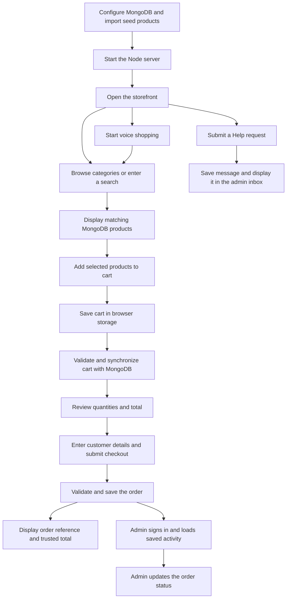
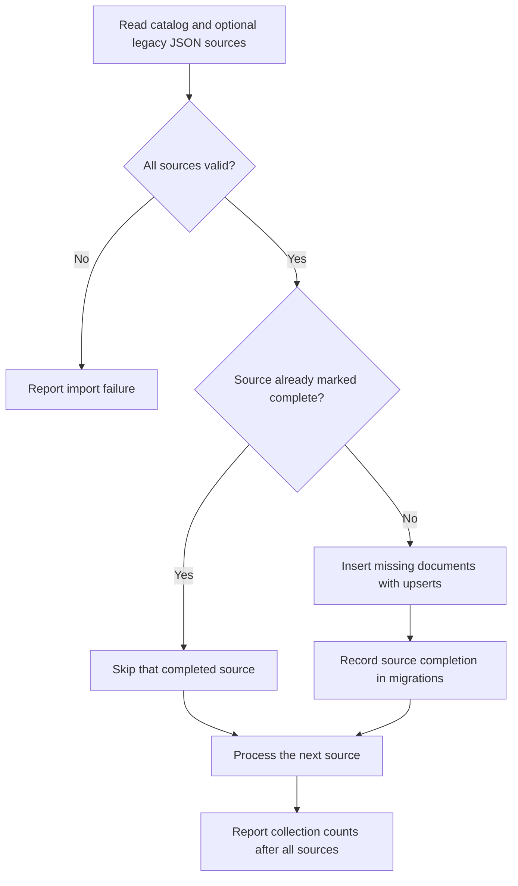
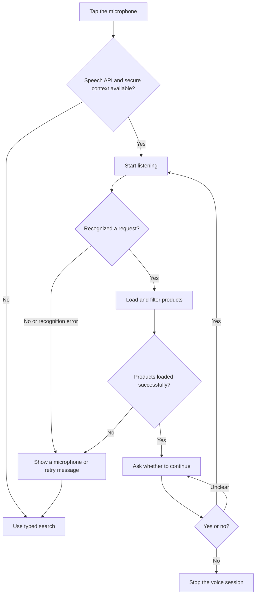
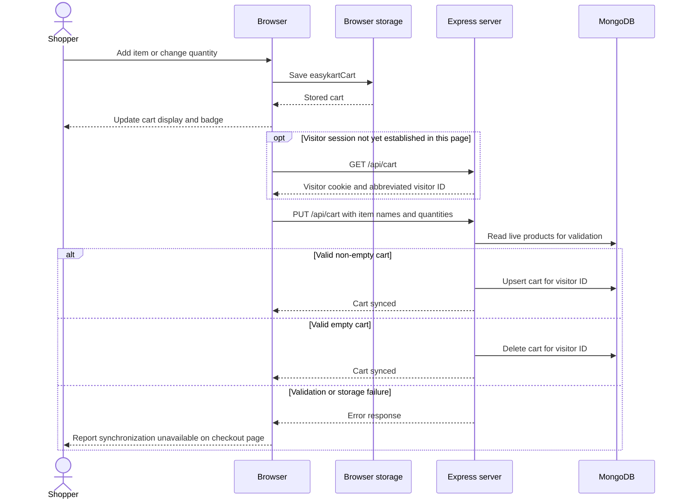
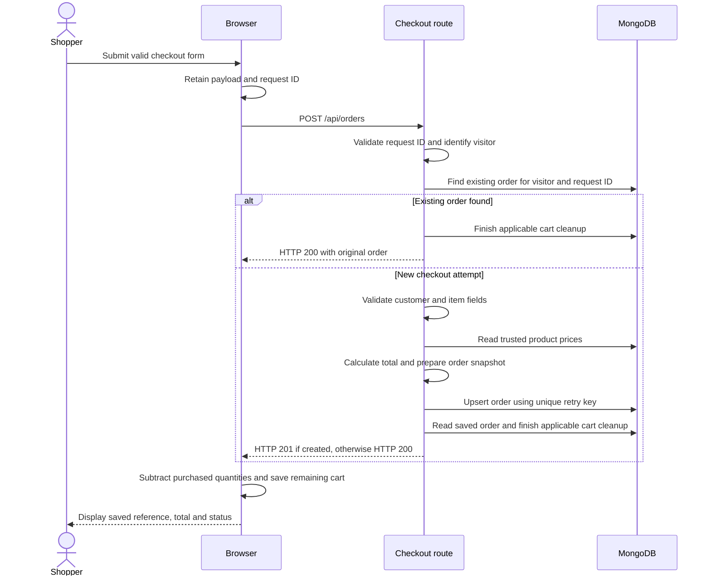
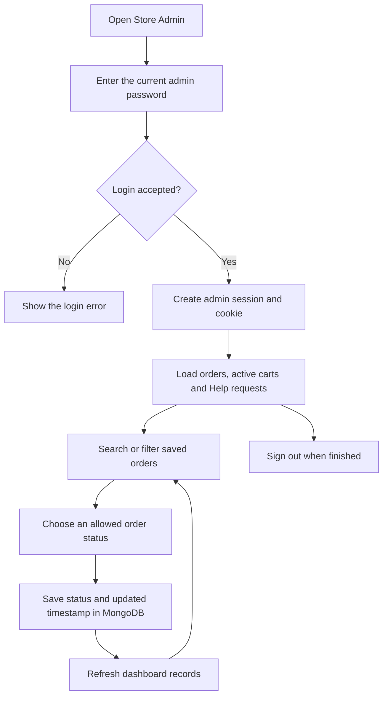

# EasyKart project workflow

This document follows a shopping session from preparation to saved records.
The diagrams describe the existing implementation, including its error paths.
Use the [project guide](project-guide.md) for file responsibilities and terminology.
Use the [demo checklist](demo-checklist.md) to demonstrate the flow in a browser.

## Complete project flow

The diagram shows the normal connected flow.
Browser cart editing can still succeed when server synchronization fails.
An order receipt requires a successful server response confirming the saved order.
Payments, email delivery and physical fulfilment are outside this workflow.

## 1. Prepare the local environment

| Step | Action | Expected result |
| --- | --- | --- |
| 1 | Install the locked dependencies with `npm ci` | Node can load Express and the MongoDB driver |
| 2 | Configure the private `.env` using `.env.example` | The server has a MongoDB URI and database selection |
| 3 | Confirm database credentials and network access | MongoDB is reachable from the server computer |
| 4 | Run `npm run db:import` for the initial data | Product seed records and available legacy records are imported |
| 5 | Run `npm start` | Database initialization completes before the HTTP server listens |
| 6 | Open the health and product endpoints | Connectivity and a populated catalog can be checked separately |

Detailed setup is in the [README](../README.md).
The import is an explicit preparation step, not part of each page request.
The application reads live products from MongoDB after preparation.

### Import decisions

Validation of source data happens before import writes begin.
The completion marker is written only after that source's document loop finishes.
An interrupted source can therefore be retried, while completed sources are skipped.
The original JSON files are not rewritten by the importer.

## 2. Discover products

The shopper can enter through categories, typed search or voice shopping.
Typed navigation recognizes simple page keywords such as cart, categories and help.
Other typed shopping requests navigate to product results with a query string.
Voice recognition produces a transcript and passes it to the same product filtering logic.
The shopping assistant does not call a separate AI model service.

| Stage | Component | Output |
| --- | --- | --- |
| Read the request | Browser input or speech recognition | Search words and an optional budget |
| Load products | `script.js` requests the product endpoint | Current catalog records from MongoDB |
| Filter results | Browser search functions | Products matching category, words and budget |
| Render cards | Browser DOM functions | Product names, prices, images and Add to Cart controls |
| Handle no matches | Browser result display | An empty result state that can be revised with another search |

### Voice continuation

The continuation controls also provide clickable Yes and No choices.
When speech synthesis is available, the prompt finishes before answer listening begins.
Stopping voice aborts the current session and pending product request.
Microphone access and recognition support are browser prerequisites.

## 3. Build and synchronize the cart

Adding an item first changes the browser's cart.
The browser updates the visible cart and badge after saving localStorage.
It separately queues synchronization with the local Express server.

If the browser cannot save localStorage, the UI reports that save failure separately.
If only server synchronization fails, the cart may remain available in that browser.
The server checks quantities and product names again rather than trusting local records.
The visitor cookie identifies anonymous activity, not a signed-in customer account.

## 4. Review and submit checkout

The shopper reviews quantities before opening the checkout form.
The form collects a customer name, email and delivery address.
The checkout button is disabled while a submission is in progress.
The browser waits for its cart synchronization queue and visitor session before sending.

This sequence shows successful processing, rather than every possible error branch.
The unique key also handles races where two new attempts arrive concurrently.
The saved price comes from MongoDB, not from a price submitted by the browser.
The displayed receipt states that no payment has been collected.

### Retry and failure decisions

| Outcome | Browser behavior | Next action |
| --- | --- | --- |
| Form validation fails | No order request is sent | Correct the highlighted input |
| Server returns a client error | Discard the pending checkout payload | Correct the input and submit again |
| Network failure or server error | Retain the pending payload in page memory | Retry from the same page with the same request ID |
| Server returns an existing order | Use the original saved reference | Treat the retry as confirmation of that order |
| Server confirms a new order | Display the saved receipt | Find the reference in the admin dashboard |

Retry retention lasts for the open page; reloading does not preserve pendingOrder.
A new request ID is a separate attempt, even if the selected products are identical.
Cart cleanup uses timestamps so an older checkout does not remove a newer cart.
These operations are implemented as separate database actions, not one transaction.

## 5. Review orders as the administrator

The status list contains New, Confirmed, Packed, Delivered and Cancelled.
An admin can choose any member of that list; the code does not enforce a strict progression.
The update changes the saved record without dispatching goods or contacting a payment system.
The dashboard's order value excludes Cancelled orders and is not collected revenue.
Restarting Node clears admin sessions, so the administrator must sign in again.

## 6. Submit and review a Help request

| Step | Shopper or server action | Saved or displayed result |
| --- | --- | --- |
| 1 | Shopper completes name, email and message | Form fields remain in the browser until submission |
| 2 | Browser validates the form and sends JSON | Help submission reaches the Node server |
| 3 | Server trims and validates the text | Invalid submissions receive an error |
| 4 | Server adds submitted_at and inserts a document | A record is saved in help_requests |
| 5 | Browser receives success | Confirmation is shown and the form is reset |
| 6 | Administrator refreshes the Help view | The saved message appears in the inbox |

The Help workflow stores a message for review.
It does not send email, make a phone call or open a separate support chat.
If saving is not confirmed, the page keeps the form entries and reports the problem.

## 7. Verify the saved result and restart

For a complete demonstration, follow one record through each relevant layer.
Use the same selected database before and after restarting the server.

1. Browse to a product and record its current price.
2. Add a small quantity and confirm the browser cart total.
3. Submit checkout using sample customer details.
4. Note the displayed order reference and full record ID in the database.
5. Find that order in Store Admin and update its status to Packed.
6. Refresh MongoDB's orders view and confirm the saved status.
7. Submit a sample Help message and find it in the dashboard and database.
8. Stop Node with Ctrl+C, then run `npm start` again.
9. Sign in to Store Admin again and confirm both saved records remain.

| Checkpoint | Evidence to observe |
| --- | --- |
| Catalog ready | Health succeeds and the product list is populated |
| Cart synchronized | An active cart appears under its anonymous visitor label |
| Checkout stored | The same order reference is visible in the receipt, admin and database |
| Status stored | Packed is visible after refreshing admin and the database viewer |
| Help stored | The sample message is visible in the inbox and help_requests |
| Persistence | Saved order status and Help record remain after reconnecting |

An offline test result alone does not replace this connected demonstration.
The integration runner automates many persistence checks using a separate test database.
See [testing](testing.md) for its prerequisites, scope and cleanup behavior.

## Workflow ownership

| Concern | Source of truth | Where the user sees it |
| --- | --- | --- |
| Available product and current price | MongoDB products | Product cards and server-calculated checkout |
| Current local cart | Browser localStorage | Cart page and navigation badge |
| Last synchronized cart | MongoDB carts | Active carts in Store Admin |
| Confirmed demo order | MongoDB orders | Checkout receipt and admin order view |
| Order status | MongoDB orders | Admin status selection |
| Submitted Help message | MongoDB help_requests | Form confirmation and admin inbox |
| Admin login session | Node process memory | Access to protected dashboard actions |

This separation explains why a visible browser cart is not proof of a database write,
and why an expired admin session does not mean that stored orders were deleted.
